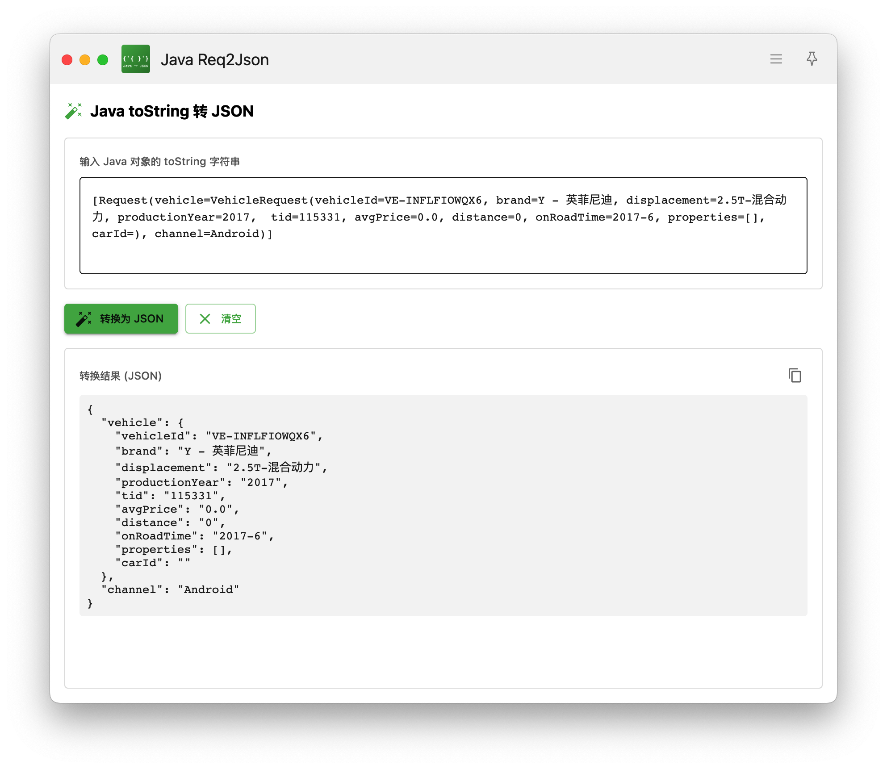

<h1 align="center">uTools Java toString 转 JSON</h1>
<div align="center">

一款轻量级的 uTools 插件，可将 Java 对象的 `toString()` 输出字符串快速转换为 JSON 格式

[](https://u.tools/)
[](https://react.dev/)
[](https://codemirror.net/)
[](https://webpack.js.org/)

</div>

## 功能特性

- 支持 Lombok `ClassName(k=v)`、IDE 生成的 `ClassName{k='v'}`、`List`、`Map`、裸字段列表
- 输入即转换，粘贴立即出结果；括号不匹配时给出提示并可一键定位，不会卡死
- 解析在 Web Worker 中进行，MB 级内容界面依然流畅
- JSON 结果语法高亮、可折叠、`⌘F` 搜索
- 默认开启：Java Date 转时间戳（CST 按 +08:00）、数字转数值（超 15 位保留字符串），可随时关闭；缩进 2/4 可选
- 一键复制格式化 / 压缩 JSON（`⌘⇧C`）
- 通过关键字进入时自动读取剪贴板中的 toString 内容
- 左右分栏可拖拽，跟随系统深色/浅色主题



## 安装方法

### 方式一：通过 uTools 插件市场安装（推荐）

1. 打开 uTools
2. 进入插件市场
3. 搜索 "Java转JSON"
4. 点击安装

### 方式二：本地安装

1. 克隆本仓库：
   ```bash
   git clone https://github.com/yourusername/JavatoString2Json.git
   cd JavatoString2Json
   ```

2. 构建项目：
   ```bash
   npm install
   npm run build
   ```

3. 在 uTools 中安装本地插件：
   - 打开 uTools 设置 -> 插件 -> 开发模式
   - 点击 "安装本地插件"，选择项目根目录

## 使用方法

### 快速上手

1. 按 `Alt + Space`（或配置的 uTools 快捷键）打开 uTools
2. 输入 `Java转JSON` 或 `javaToJson`
3. 将 Java 对象的 `toString` 字符串粘贴到输入框
4. 自动转换为 JSON 格式
5. 复制结果

### 支持的格式示例

#### 数组格式
```java
[Request(vehicle=VehicleRequest(vehicleId=VE-INFLFIOWQX6, brand=英菲尼迪), channel=Android)]
```

#### 对象格式
```java
User{id=123, name="张三", age=25, address=Address{city="北京", district="朝阳区"}}
```

#### 基本类型
```
id=123, name="test", active=true, score=98.5
```

#### 嵌套支持
```java
Order{id=ORD001, items=[Item{name="商品A", price=100}, Item{name="商品B", price=200}]}
```

### 插件配置

插件入口：`uTools -> Java转JSON`

| 配置项 | 说明 |
|--------|------|
| 关键字 | `Java转JSON` |
| 输入类型 | 文本输入 |
| 匹配模式 | 模糊匹配 |

## 技术栈

- **前端框架**：React 19.2
- **编辑器**：CodeMirror 6
- **构建工具**：Webpack 5
- **样式方案**：Less + CSS 变量（无 UI 组件库）
- **JavaScript 运行环境**：Electron（uTools 内置）

## 开发说明

### 项目结构

```
JavatoString2Json/
├── public/              # 静态资源
│   ├── plugin.json     # uTools 插件配置
│   ├── logo.svg        # 插件图标
│   └── index.html      # 入口 HTML
├── src/
│   ├── App.js          # 布局与 uTools 接入
│   ├── platform.js     # uTools 能力封装（浏览器中也可运行）
│   ├── parser/         # 解析器、Web Worker、useJsonConverter Hook
│   ├── components/     # CodeEditor、SplitPane、StatusBar 等组件
│   ├── index.less      # 设计变量与样式
│   └── ErrorBoundary.js # 错误边界
├── test/               # 解析器单测（node:test）
├── bridge/
│   └── preload.js      # Electron 预加载脚本
├── dist/               # 构建输出目录（生成）
├── webpack.config.js   # Webpack 配置
├── package.json        # 依赖管理
└── README.md           # 本文件
```

### 开发命令

```bash
# 安装依赖
npm install

# 开发模式（监听文件变化）
npm run dev

# 生产构建
npm run build

# 解析器单测
npm test
```

不在 uTools 中也可以调试：直接用浏览器打开 `dist/index.html`（`file://` 下浏览器不允许 Worker，会自动改为主线程解析）。

### 核心实现

核心解析函数位于 `src/parser/parseJavaToString.js`，返回 `{ value, warnings }`：

- 基于下标扫描的递归下降解析，每轮循环都会前进，畸形输入只产生 warning，不会死循环
- 字段列表中逗号后面是 `key=` 时才视为分隔符，`remark=a, b` 这类值不会被拆开
- 引号字符串以“引号后紧跟分隔符”判断结束，`name='O'Brien'` 也能正确解析
- `ClassName@hash` 仅在其后是分隔符时识别，邮箱等内容不会被截断

### uTools API

```javascript
// 监听插件进入事件
window.utools.onPluginEnter(({ code, type, payload }) => {
  // code: 'javaToJson'
  // type: 'text'
  // payload: 用户选中的文本
})

// 复制文本到剪贴板
window.utools.copyText(text)

// 监听插件退出事件
window.utools.onPluginOut(() => {
  // 清理逻辑
})
```

### 安全规范

⚠️ **重要**：本项目遵循 Electron 安全实践

- 不在渲染进程直接暴露 Node.js 模块（`fs`、`child_process` 等）
- 通过 `bridge/preload.js` 封装必要的系统服务
- 使用 `window.services` 访问受限 API

## 许可证

MIT License

## 贡献

欢迎提交 Issue 和 Pull Request！

## 致谢

- [uTools](https://u.tools/) - 强大的 productivity launcher
- [React](https://react.dev/) - 用于构建用户界面
- [CodeMirror](https://codemirror.net/) - 高性能的代码编辑器

---

<div align="center">

Made with ❤️ by [小光光](https://github.com/itguang)

</div>
